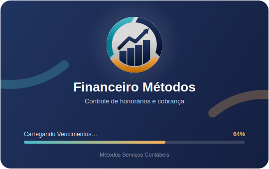
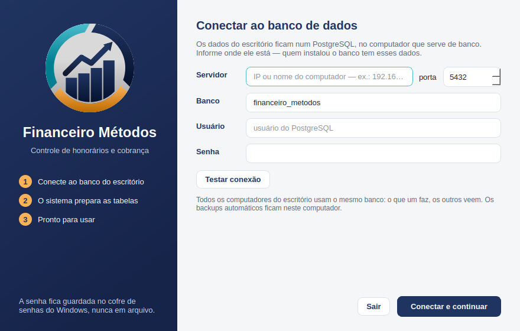

<div align="center">


# Financeiro Métodos

**Controle de honorários e cobrança do escritório Métodos Serviços Contábeis**

Registra honorários, calcula o juros de atraso dia a dia, prepara a cobrança pronta para
o WhatsApp e acompanha a conversa de cobrança por e-mail com o financeiro.


[Recursos](#recursos) ·
[Telas](#telas) ·
[Como rodar](#como-rodar) ·
[Instalar no Windows](#instalar-no-windows) ·
[Arquitetura](#arquitetura) ·
[Manual completo](docs/MANUAL.md)

</div>

---

## Por que existe

O escritório controlava honorários numa planilha. O **Financeiro Métodos** substitui a
planilha por um programa de desktop, com o banco num PostgreSQL da rede que todos os
computadores do escritório compartilham.

O sistema é feito para quem cobra. Ele sempre mostra o que venceu, quanto está hoje com
juros, quem já foi cobrado e o que cada cliente respondeu.

> **O sistema não envia nada sozinho.** Ele monta a mensagem, a imagem ou o e-mail, e
> você confere. A cobrança só é registrada, e o e-mail só sai, depois da sua
> confirmação. Copiar não é enviar.

## Recursos

<table>
<tr>
<td width="50%" valign="top">

### 💰 Cobrança
- **Vencimentos** em três abas (A vencer, Atrasados e Pagos), ordenados pelo número da
  empresa e agrupados quando uma empresa tem mais de um honorário
- Juros fixo em R$ por dia, por cliente, com histórico de vigência
- Mensagem de WhatsApp pronta e **imagem da cobrança** com QR code do Pix
- Cobrança em lote, renegociação, acordo com prazo e abono justificado
- Respostas dos clientes registradas: promessa, renegociação, contestação
- Imagem **"Pagamento confirmado"** para agradecer o cliente

</td>
<td width="50%" valign="top">

### ✉️ Gerenciador de e-mail
- Lê **só a pasta Cobranças**, no Outlook / Microsoft 365 ou no Gmail
- Compara a lista do financeiro com o sistema: quem continua e quem **saiu da lista**
- Prepara a baixa de quem saiu, que só é feita depois da sua confirmação
- Corrige as linhas que não bateram com nenhum honorário
- Monta a resposta com o que sobrou em aberto e os retornos de cada cliente, e envia na
  mesma conversa

</td>
</tr>
<tr>
<td valign="top">

### 📋 Cadastros e honorários
- Clientes PF, PJ e domésticas, com contatos e honorário recorrente no próprio cadastro
- Mês a mês, recorrentes e avulsos (IRPF, alterações, certificados…)
- Geração da competência com prévia. Pode ser **automática**, se você quiser
- Vencimento em dia não útil passa para o **próximo dia útil** (feriados nacionais, do ES e
  de Vila Velha)
- **"Paga pela empresa"**: a pessoa física não gera honorário próprio

</td>
<td valign="top">

### 📊 Gestão
- **Painel** do ano: emitido × quitado, entradas no caixa, origem do faturamento
- **Ranking dos atrasados** e **análise de juros** por cliente, com exportação em PDF
- **Notificações** do que vence hoje, promessas vencidas e e-mails novos
- Planilha Excel, extrato de débitos em PDF e importação da planilha antiga
- Importação personalizada: a coluna do Excel de cada informação, layout salvo e
  exportado como planilha-modelo, sem duplicar cliente nem honorário já cadastrado
- Backup do banco do servidor numa cópia local, e restauração com tudo ou nada

</td>
</tr>
</table>

## Telas

<table>
<tr>
<td width="50%"><br><sub><b>Abertura</b>: o canhoto, com a barra carregando</sub></td>
<td width="50%"><br><sub><b>Primeiro uso</b>: conexão com o banco do escritório</sub></td>
</tr>
</table>

O que cada tela faz, o fluxo da cobrança e do e-mail e o modelo da imagem estão no
**[manual de uso](docs/MANUAL.md)**.

## Como rodar

Para rodar a partir do código, você precisa do Python 3.12:

```bash
python3 -m venv .venv
.venv/bin/pip install -e ".[dev]"
.venv/bin/python main.py
```

Rodando do código, o banco é um SQLite em `dados/honorarios.db`, que fica fora do git.

| Variável / opção | Efeito |
|---|---|
| `HONORARIOS_DADOS=/outra/pasta` | usa um SQLite em outra pasta (uma cópia, por exemplo) |
| `HONORARIOS_BANCO_URL=postgresql+psycopg://…` | usa qualquer banco, por exemplo um PostgreSQL de teste |
| `--primeiro-uso` | mostra a tela de conexão sem gravar nada |

### Dados de exemplo

Para conhecer o sistema sem usar dados reais:

```bash
.venv/bin/python scripts/dados_exemplo.py            # cria, se o banco estiver vazio
.venv/bin/python scripts/dados_exemplo.py --limpar   # apaga tudo e recria
.venv/bin/python scripts/mais_pendencias.py          # mais atrasados, para simular o e-mail
```

O exemplo cria clientes fictícios (PF, PJ e domésticas) com nove meses de competências:
pagamentos em dia, com atraso e parciais, abono, IRPF, avulsos, renegociação e cobranças
com promessa cumprida e vencida.

### Testes

```bash
.venv/bin/python -m pytest                 # tudo, inclusive as telas (sem servidor gráfico)
.venv/bin/python -m pytest testes/dominio  # só as regras, sem Qt
.venv/bin/ruff check src testes scripts
HONORARIOS_TESTE_PG=postgresql+psycopg://… .venv/bin/python -m pytest   # contra o PostgreSQL
```

## Usar com o Claude (servidor MCP)

O sistema também é um servidor [MCP](https://modelcontextprotocol.io): o Claude consulta e
grava nos honorários com as mesmas regras das telas (juros, validações, log de alterações).
São 38 ferramentas — clientes, honorários, pagamentos, cobranças, contratos, configurações,
e-mail do financeiro e WhatsApp — **sem modo somente leitura**: o que a tela faz, o Claude faz,
inclusive excluir e estornar. As que apagam ou desfazem levam `destructiveHint` para o cliente
poder pedir confirmação.

- **E-mail do financeiro:** verifica a pasta "Cobranças", lê o e-mail e já confere a lista com
  o sistema (quem continua, quem saiu, o que não bateu), dá baixa em quem saiu e responde com a
  lista atualizada — como rascunho `.eml` aberto no Outlook ou enviado pela conta do sistema.
  O rascunho direto na pasta Rascunhos do Outlook pediria a permissão `Mail.ReadWrite` no
  aplicativo da Microsoft; com o conector do Microsoft 365 ligado no Claude, ele pode usar o
  `montar_resposta_financeiro` (que devolve o corpo e o id do e-mail) e criar o rascunho por lá.
- **WhatsApp:** `cobrar_por_whatsapp` abre a conversa no telefone do contato com a mensagem do
  modelo e a chave Pix sozinha na última linha (da imagem não dá para copiar) e deixa a imagem
  de cobrança copiada para colar com Ctrl+V. O WhatsApp não aceita envio automático: quem aperta
  Enviar é você; a cobrança só é registrada quando pedido.

Para ligar: **Configurações → Claude (MCP)**. Lá ficam o **Testar conexão** (abre o servidor
como o Claude abriria e confere a resposta), o **Conectar ao Claude Desktop** (grava o sistema
na configuração dele, sem mexer nos outros servidores; depois é só reabrir o Claude) e o
**Copiar comando do Claude Code**. A aba também mostra a última vez que o Claude usou uma
ferramenta. No instalado, o servidor é o `FinanceiroMetodosMCP.exe`, ao lado do programa; no
código, `.venv/bin/python -m honorarios.mcp_servidor` (o `.mcp.json` já o registra aqui).

O servidor usa o mesmo banco do programa (a conexão do primeiro uso; `HONORARIOS_DADOS` aponta
para um SQLite de testes). Para liberar tudo sem perguntar a cada chamada, permita
`mcp__financeiro-honorarios__*` nas permissões do Claude Code.

## Instalar no Windows

O instalador **Financeiro Métodos** cria o atalho na área de trabalho e no menu Iniciar.

1. **Gerar o instalador** num Windows com Python 3.12 e o
   [Inno Setup 6](https://jrsoftware.org/isinfo.php):
   ```bat
   python -m venv .venv
   .venv\Scripts\pip install -e .[empacotar]
   instalador\gerar_instalador.bat
   ```
   O resultado sai em `instalador\saida\Instalador_Financeiro_Metodos_<versão>.exe`.
2. **No computador do banco**, uma vez: instale o PostgreSQL, crie um usuário para o
   sistema e libere a rede do escritório (`listen_addresses`, `pg_hba.conf` e a porta 5432).
3. **Na primeira abertura** de cada computador, informe o servidor, a porta, o banco, o
   usuário e a senha. O sistema testa a conexão, cria o banco se ele ainda não existir e
   prepara as tabelas. A senha fica no cofre de senhas do Windows.

Backups, atualização e o passo a passo completo estão em **[docs/INSTALACAO.md](docs/INSTALACAO.md)**.

## Arquitetura

```
src/honorarios/
├── dominio/     regras puras, sem Qt e sem banco (juros, mensagens, feriados, valores)
├── infra/       modelos SQLAlchemy, migrações Alembic, esquema do banco
├── servicos/    orquestração (clientes, honorários, cobrança, e-mail, backup…)
├── ui/          PySide6: paineis/, dialogos/, comum/ (tabelas, campos, tema, logo)
├── recursos/    ícone, logo e fundo da imagem da cobrança (SVG)
└── config/      pastas locais, conexão com o banco e log
instalador/      PyInstaller (.spec), Inno Setup (.iss) e ícones
scripts/         dados de exemplo e geração dos ícones
```

A regra de juros e a geração de mensagem ficam em `dominio/` e não importam Qt, por isso
dá para testar sem abrir janela. As listas grandes usam `QAbstractItemModel`, nunca um
widget por linha. Cada tela é montada na primeira vez que é aberta e só lê o banco de
novo quando os dados mudaram.

### Decisões que valem saber

- **Juros** é um valor fixo em R$ por dia, com histórico de vigência. Uma mudança vale
  **a partir da data dela**, nunca para trás.
- **Dinheiro é `Decimal`** do começo ao fim. O arredondamento acontece uma vez só, no total.
- **Baixa congela** data, dias de atraso, juros, desconto e total. Mudar o juros depois
  não altera o que já foi pago.
- **Nada é apagado**: há exclusão lógica e estorno, com registro em `log_alteracao`.
- **Dados pessoais**: banco, planilhas, backups e exportações estão no `.gitignore`.
  Nenhum dado real de cliente entra no repositório nem nos testes.
- **Senhas** do banco e do e-mail ficam no cofre de senhas do sistema, nunca em arquivo.

O detalhamento está em [docs/ESPECIFICACAO.md](docs/ESPECIFICACAO.md) e
[docs/DECISOES.md](docs/DECISOES.md).

---

<div align="center">

<br>
<sub>Feito para o dia a dia da cobrança na Métodos Serviços Contábeis.</sub>
</div>
